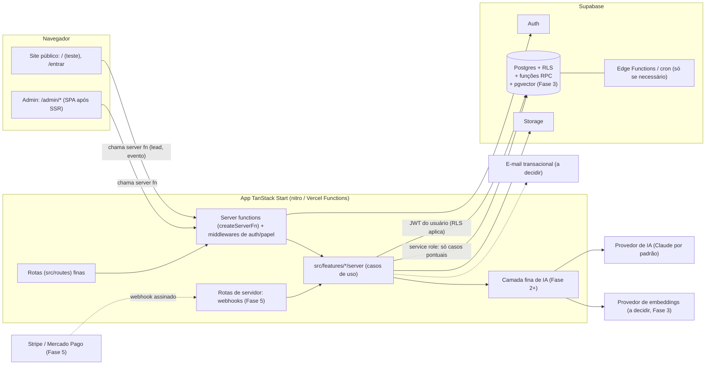

# 01 — Arquitetura

Princípios (AGENTS.md global): simplicidade primeiro, menor versão ponta a ponta, sem camadas especulativas, reaproveitar dependências existentes, sem backward compat. Decisões fixas estão em `docs/adr/`.

## 1. Visão geral



Fluxo típico de leitura no admin: rota → `loader`/TanStack Query → server function (middleware: sessão válida + papel permitido) → cliente Supabase **com o JWT do usuário** → Postgres aplica RLS → dados. Duas barreiras independentes (servidor e banco). O navegador nunca recebe a service role e nunca decide autorização.

## 2. Camadas

Adaptação do padrão do time (DDD/hexagonal) ao tamanho real do projeto: sem `domain/application/infrastructure` formais por feature enquanto não houver regra de negócio que justifique. A fronteira que importa é mantida: **UI não fala com o banco; casos de uso não importam React; features não importam umas das outras.**

| Camada | Onde | Responsabilidade | Pode importar |
|---|---|---|---|
| Rotas | `src/routes/**` | Composição, `head`, `beforeLoad` (redirecionar), `loader`. Sem regra de negócio | `features/*` (apenas o `index.ts` público), `shared`, `components/ui` |
| Apresentação | `src/features/<f>/components`, `hooks` | Componentes e hooks de UI da feature | própria feature, `shared`, `components/ui`, `lib` |
| Aplicação (server) | `src/features/<f>/functions/*.ts` | Server functions (`createServerFn`) e casos de uso: validam input (zod), autorizam, orquestram, devolvem DTO | própria feature, `shared/server`, `integrations` |
| Domínio puro | `src/features/<f>/domain/*.ts` (só quando existir regra) | Funções puras testáveis (ex.: pontuação do Eneagrama, estágios do funil, orçamento de tokens). Sem I/O | nada de infra |
| Integrações | `src/integrations/<sistema>/` | Clientes externos: `supabase/` (client browser, client server, types gerados), `ai/`, `payments/` | libs externas |
| Compartilhado | `src/shared/` | Tipos e utilitários usados por 2+ features: papéis, status de módulo, formatadores, componentes de layout | `lib`, `integrations` |

Regra de ouro de imports: `feature A` nunca importa `feature B`. Se duas precisam do mesmo conceito (ex.: `Contact` usado em CRM e em Leads), o conceito vive em **uma** feature dona (`crm`) e a outra recebe por rota/props, ou o tipo sobe para `shared`. Leads não é feature separada: é uma visão de `crm` (ADR 0004).

Fronteira server/client no TanStack Start: código que usa service role, segredos ou `process.env` fica em arquivos `*.server.ts` ou dentro do `handler` de `createServerFn`, nunca importado de componente. **Pasta `functions/`, nunca `server/`:** o plugin de import-protection do TanStack Start bloqueia no build qualquer arquivo sob `**/server/**` (e `*.server.ts`) importado por código do navegador, e rotas/componentes importam as server functions para chamá-las via RPC. Por isso as server functions vivem em `functions/`; só módulos que de fato nunca podem chegar ao cliente (service role, leitura de segredos, cookies) usam o sufixo `*.server.ts`. Antes de implementar, conferir a doc de `@tanstack/react-start` 1.167 (context7 ou docs oficiais) para middleware de server function e cookies; `createMiddleware` já é usado em `src/start.ts` (request middleware). O aviso do `AGENTS.md` sobre `node_modules/next/dist/docs/` é do Next.js e não se aplica a este repositório (stack é TanStack Start).

## 3. Estrutura de pastas proposta

```
src/
├── routes/
│   ├── __root.tsx                 # shell; lang pt-BR; 404/erro em português
│   ├── index.tsx                  # só compõe features/eneagrama (teste público)
│   ├── entrar.tsx                 # login (Supabase Auth)
│   ├── admin.tsx                  # layout route: guard + sidebar + <Outlet/>
│   └── admin/
│       ├── index.tsx              # Dashboard
│       ├── contatos/index.tsx     # Clientes/CRM/Leads são visões do mesmo dado
│       ├── contatos/$id.tsx
│       ├── marketing/index.tsx    # gasto manual na Fase 1
│       ├── configuracoes/usuarios.tsx
│       └── …                      # demais módulos: página "status do módulo" até existirem
├── features/
│   ├── eneagrama/                 # teste público + resultado
│   │   ├── components/            # Intro, Quiz, Results (extraídos de index.tsx)
│   │   ├── domain/scoring.ts      # computeScores puro + testes
│   │   ├── data/                  # enneagram.ts (instrumento versionado)
│   │   └── functions/             # saveQuizResult
│   ├── crm/                       # contatos, estágios, notas, leads
│   │   ├── components/ domain/ functions/ schemas.ts
│   ├── tracking/                  # registro de eventos do funil (client helper + server fn)
│   ├── marketing/                 # marketing_spend; depois campanhas/UTM
│   ├── dashboard/                 # queries/RPC e cartões de métrica
│   ├── auth/                      # login, sessão, middleware de papel
│   ├── users/                     # gestão de usuários e papéis (admin)
│   └── admin-shell/               # sidebar, registry de módulos e status, badges
├── integrations/
│   └── supabase/
│       ├── client.ts              # browser (publishable key, sessão)
│       ├── server.ts              # server: client por request (JWT) e client service role
│       └── types.ts               # GERADO por `supabase gen types`; não editar
├── shared/
│   ├── roles.ts                   # union de papéis + matriz papel × módulo (fonte única)
│   ├── module-status.ts           # Implementado / Em desenvolvimento / …
│   └── ui/                        # StatusBadge, EmptyState, MetricCard
├── components/ui/                 # shadcn (não mexer na estrutura)
├── lib/                           # utils.ts, error-capture, etc.
supabase/
├── migrations/                    # SQL versionado (data-engineer)
├── seed.sql                       # dados de teste locais
└── tests/                         # testes de RLS/funções (pgTAP ou script)
docs/{arquitetura,adr}/
```

Notas:
- `features/<f>/index.ts` exporta a API pública da feature (o que rota pode importar).
- Para os módulos sem dados, o registro em `admin-shell` gera a página padrão "Módulo X: Planejado (Fase N). Depende de: Y". Não construir telas vazias fingindo função (regra do dono).
- A matriz papel × módulo vive em **um** arquivo (`shared/roles.ts`) e alimenta: itens visíveis da sidebar, guard de rota e middleware de server function. O banco tem a versão dele (policies), testada contra a mesma matriz.

## 4. Padrões de acesso a dados

| Padrão | Regra |
|---|---|
| Caminho de escrita | Sempre por server function com `zod` no input. O browser não escreve direto em tabelas do CRM/eventos |
| Cliente Supabase no servidor | Dois fabricados em `integrations/supabase/server.ts`: (a) **por request**, criado com o JWT da sessão (cookies via `@supabase/ssr`), é o padrão e deixa a RLS valer; (b) **service role**, usado só em casos nomeados e comentados: captura de lead anônima, gravação de evento anônimo, webhooks, jobs, escrita de `ai_usage`. Cada uso do (b) tem de justificar por que RLS não serve. **Usos atuais (fonte única; atualizar ao adicionar):** (1) `features/users/functions/users-fns.ts` `listUsersFn`, que lista e-mails em `auth.users` (inacessível por RLS), só depois de `requireRole(["admin"])`. O cliente vive em `integrations/supabase/admin-client.server.ts` |
| Cliente no browser | Só `auth` (login/logout/refresh) e, no futuro, Realtime/Storage com políticas. Dados do admin passam por server function |
| Leitura | TanStack Query no admin (cache, invalidação). Páginas públicas usam `loader` |
| Métricas | Funções SQL (RPC) por período, `security invoker` ou `definer` revisado, que devolvem agregados. O cliente não agrega linhas (ADR 0005) |
| Paginação | Cursor (`id > $last`), nunca OFFSET; `select` explícito; limite máximo em toda lista (regra de DB global) |
| Erros | Server function lança erro tipado (`AppError` com `code`), UI traduz em mensagem amigável; detalhe só em log de servidor; nada de `catch {}` |
| Tipos | `types.ts` gerado do banco; DTOs de saída definidos em `features/*/schemas.ts` (zod) para não vazar colunas |
| Migrações | Só via arquivos em `supabase/migrations/` (data-engineer). Aplicar em dev → conferir → prod. Nunca SQL manual em produção |

## 5. Segurança, RLS e papéis

### 5.1 Princípios

1. Autorização no servidor (middleware da server function) **e** no banco (RLS). Esconder item de menu é só UX.
2. Papéis em `user_roles` (um usuário pode ter vários), consultados por `has_role(uid, role)` e `is_staff(uid)` nas policies (ADR 0003). Nenhuma coluna `role` em `profiles`. Mudança de papel só via função/ação de admin, com registro em `audit_log`.
3. Toda tabela com `ENABLE ROW LEVEL SECURITY`, sem policy = sem acesso. `anon` não tem acesso a nada de CRM/eventos/resultados; entradas públicas passam por server function.
4. Service role só no servidor, em variável sem prefixo `VITE_`.
5. Primeiro admin é criado por script/seed controlado pelo Jonatan (não existe rota pública que conceda papel).
6. Ações sensíveis de staff (ver conteúdo individual, exportar, alterar papel, excluir) geram linha em `audit_log` (quem, o quê, alvo, quando, motivo quando exigido).

### 5.2 Matriz papel × módulo (proposta; "A" = apenas agregados, nunca conteúdo individual)

L = ler, E = escrever/gerenciar, - = sem acesso. Profissional e cliente têm áreas próprias fora do `/admin` (Fases 3 e 6); aqui só o que valem para o painel.

| Módulo | admin | operador | marketing | financeiro | profissional | cliente |
|---|---|---|---|---|---|---|
| Dashboard | L (tudo) | L (operacional) | L (funil/marketing) | L (financeiro) | - | - |
| Clientes | E | E | L (sem contato direto, só segmentos) | L (assinatura) | - | - |
| CRM | E | E | L | - | - | - |
| Leads | E | E | E | - | - | - |
| Marketing | E | L | E | L (gasto) | - | - |
| The Self AI | E | L | - | - | - | - |
| Mentor IA | E (config) | A | - | - | - | usa o produto (fora do admin) |
| Eneagrama | E | L (agregados) | A | - | - | usa o teste |
| Jornadas | E | E | L | - | - | - |
| Assinaturas | E | L | - | E | - | - |
| Marketplace | E | L | - | L | - | - |
| Profissionais | E | E | - | L | só o próprio perfil (fora do admin) | - |
| Financeiro | L | - | - | E | só o próprio repasse (fora do admin) | - |
| Analytics | L | L | L | L (receita) | - | - |
| Conteúdo | E | E | E | - | - | - |
| Integrações | E | - | - | L | - | - |
| Configurações | E (usuários, papéis) | - | - | - | - | - |

Regras transversais:
- Conteúdo de conversas do Mentor IA, memórias e respostas individuais do teste: **nenhum papel de staff lê por padrão**. Acesso individual excepcional exige papel `admin`, motivo registrado, e gera `audit_log`; o usuário pode ser notificado (a definir com jurídico). Staff vê contagens, distribuições e médias (ADR 0007).
- `profissional` jamais lê dados de cliente sem vínculo ativo e compartilhamento explícito do cliente por escopo (Fase 6; fora desta fase de arquitetura detalhada).
- Fase 1 implementa apenas: admin, operador, marketing, financeiro. `profissional` e `cliente` existem no enum, sem telas.

### 5.3 Guard de rota

`src/routes/admin.tsx` (layout): `beforeLoad` chama uma server function `getAuthContext` (sessão + papéis). Sem sessão: redireciona para `/entrar?next=…`. Sessão sem papel de staff: 403 (página "sem permissão"). Cada página filtra por papel via a matriz. O `beforeLoad` roda também no cliente em navegação, por isso o dado vem sempre de server function, não de estado local. **Toda server function de `/admin` usa um middleware (`requireRole([...])`)**; sem exceção. Um teste automatizado percorre todas as server functions do admin e falha se alguma não declarar middleware.

## 6. LGPD

| Requisito | Como a arquitetura atende |
|---|---|
| Base legal e finalidade | Consentimento específico e destacado (checkbox não pré-marcado) por finalidade: (1) receber contato/comunicação, (2) guardar resultado do teste ligado à pessoa, (3) memória do Mentor por categoria (Fase 3). Tabela de consentimentos append-only: quem, finalidade, versão do texto, data, origem (IP em hash, user agent resumido), revogação |
| Minimização | Lead: nome + e-mail (+ WhatsApp opcional). Eventos anônimos sem PII (id anônimo aleatório, sem IP guardado). Não coletar dado que nenhum módulo usa |
| Acesso, correção, exclusão, portabilidade | Área "Meus dados" (cliente): ver, exportar (JSON), corrigir, excluir conta e dados, revogar consentimento. Exclusão em cascata inclui resultados, memórias, embeddings, conversas; contatos do CRM são anonimizados/excluídos conforme o pedido; `events` anônimos permanecem |
| Dados sensíveis | Texto de conversa e memória podem revelar saúde mental (art. 5, II). Tratar como sensíveis por padrão: tabelas separadas, RLS estrita, criptografia em repouso do provedor, sem acesso livre da equipe, retenção definida (doc 02) |
| Retenção | Definir prazo por categoria (ex.: transcrição bruta curta; resumos enquanto a conta existir). Valores finais: validar com jurídico (**Necessita validação**) |
| Operadores e transferência internacional | Supabase, provedor de IA e de e-mail são operadores; listar em política de privacidade; cláusulas contratuais. Verificar região do projeto Supabase (preferir `sa-east-1`) e se o provedor de IA treina com dados (desligar quando houver opção) |
| Encarregado e política | Política de privacidade, termos e canal do titular publicados antes de coletar o primeiro lead (E6). Texto jurídico não é produzido por este documento |
| Incidentes | Log de auditoria + procedimento de notificação (ANPD) documentado antes da Fase 2 |
| Crianças | Teste voltado a maiores de 18; pergunta de idade ou declaração no consentimento (a validar) |
| Eneagrama ≠ diagnóstico | Aviso fixo no teste, resultado, e prompts do Mentor IA proibindo linguagem diagnóstica; Mentor IA separado de serviço clínico, com protocolo de crise (direcionar a CVV 188/serviços de emergência, sem tentar atender) |

## 7. Observabilidade

Mínimo útil, sem plataforma nova na Fase 1:

| Camada | Fase 1 | Depois |
|---|---|---|
| Erros de UI | Error boundary raiz em `__root.tsx` com `console.error` e contexto | Sentry ou similar (decisão futura) |
| Erros de servidor | `console.error` estruturado (objeto com `code`, `fn`, `userId` quando houver; **sem PII, sem conteúdo de conversa**) em server functions e middleware; `src/server.ts` já normaliza 500 | Vercel Logs / log drain |
| Auditoria | `audit_log` (ações de staff, mudança de papel, acesso excepcional) | Alertas sobre acesso a conteúdo individual |
| Negócio | `events` (funil) + dashboard | Particionamento/rollup quando volume exigir |
| IA | `ai_usage` por chamada: modelo, tokens in/out, custo estimado, latência, feature, `user_id`, status (Fase 2) | Orçamento por usuário/plano, alerta de custo |
| Saúde | Painel do Supabase (CPU, conexões) + verificação manual de preview | Uptime check |

## 8. Ambientes e segredos

| Ambiente | Banco | Uso |
|---|---|---|
| local | Supabase local (`supabase start`) ou projeto `dev` | Desenvolvimento, migrations novas, testes de RLS |
| preview/staging | Projeto Supabase `staging` (recomendado) | Conferir migration + código antes de produção |
| produção | Projeto Supabase `prod`, deploy na Vercel a partir da `main` (GitHub Actions) | Dados reais |

Variáveis (nomes propostos; valores **nunca** no repositório):

| Variável | Onde | Exposição |
|---|---|---|
| `VITE_SUPABASE_URL` | build/browser | pública |
| `VITE_SUPABASE_PUBLISHABLE_KEY` | build/browser | pública (protegida por RLS) |
| `SUPABASE_SERVICE_ROLE_KEY` | só servidor (env do projeto na Vercel) | **segredo** |
| `SUPABASE_DB_URL` ou senha do DB | só máquina de quem aplica migrations / CI | **segredo** |
| `ANTHROPIC_API_KEY` (ou do provedor escolhido) | só servidor, Fase 2 | **segredo** |
| `STRIPE_*`, `MERCADOPAGO_*`, `*_WEBHOOK_SECRET` | só servidor, Fase 5 | **segredo** |
| `APP_ENV` (`local`/`staging`/`production`) | servidor | pública |

Regras: `.env*` no `.gitignore` (hoje ausente, ver auditoria X1); commitar `.env.example` só com nomes; validar presença das variáveis no startup do servidor com zod (falhar rápido); rotacionar imediatamente se algo vazar; service role e chaves de IA nunca em prefixo `VITE_`. `src/integrations/supabase/types.ts` é gerado: não editar à mão.

## 9. IA e jobs assíncronos (visão, detalhes na Fase 2/3)

- Toda chamada de modelo passa por `src/integrations/ai/` (interface mínima: `complete`, `stream`, `embed`), no servidor, com registro em `ai_usage`. Modelo configurável por feature em um único arquivo de configuração; sem hardcode espalhado (ADR 0008).
- Streaming do chat via server route/server function com `ReadableStream`; verificar suporte nas Vercel Functions na primeira entrega da Fase 2 (risco listado).
- Trabalhos pós-conversa (resumir, extrair memória, recalcular perfil) **não** rodam dentro do request do chat: fila/cron. Opções a decidir na Fase 3: `pg_cron` + Edge Function, ou Vercel Cron. Critério: o que já estiver disponível sem nova conta.

## 10. Trade-offs principais

| Decisão | Ganha | Perde |
|---|---|---|
| Admin no mesmo app | 1 deploy, 1 auth, reuso de UI/tipos | Bundle e superfície compartilhados; mitigado por code-splitting da rota `/admin` e guard duplo |
| Server fn + RLS (duas barreiras) | Bug em uma não vira vazamento | Mais código e testes de policy |
| JWT do usuário como padrão no servidor | RLS valendo também no servidor | Cuidado com cookies/refresh em SSR (`@supabase/ssr`) |
| Sem camadas DDD completas por feature agora | Menos arquivos, entrega mais rápida | Extrair `domain/` quando surgir regra real (Mentor, financeiro); regra de imports preserva o caminho |
| Métricas em RPC | Números consistentes, auditáveis, rápidos | Lógica em SQL (versionar e testar) |
| Eventos anônimos sem PII | Funil mensurável com baixo risco LGPD | Sem vincular sessão anônima a pessoa antes do lead; vínculo só após consentimento |
