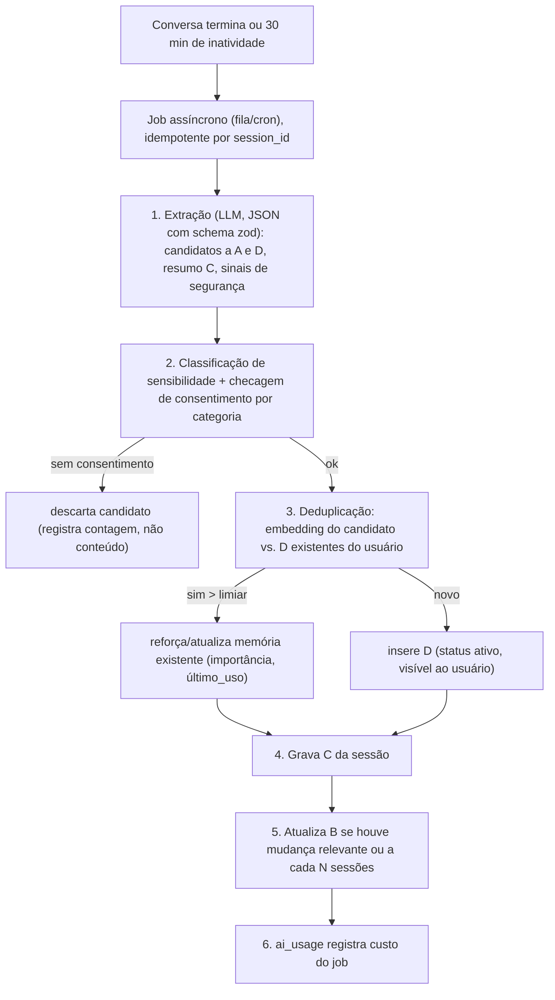
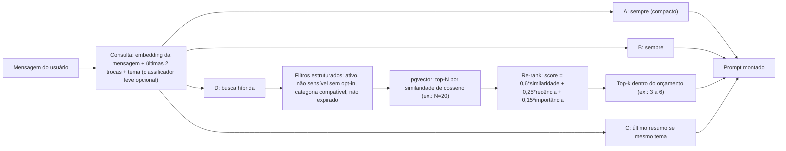

# 02 — Módulos do admin e memória do Mentor IA

Painel: **THE SELF MAP — ADMINISTRATION**, rotas `/admin/*`.

## 0. Rótulos de status (regra do dono: nada fictício que pareça funcionar)

| Rótulo | Significa | Pode exibir número? |
|---|---|---|
| Implementado | Funciona ponta a ponta com dado real, testado | Sim |
| Em desenvolvimento | Sendo construído; pode estar parcial | Só o que já tem fonte real, o resto marcado |
| Planejado | Definido, ainda não começou | Não. Página de status do módulo |
| Necessita integração | Depende de sistema externo ainda não conectado (Stripe, Mercado Pago, WhatsApp, etc.) | Não; mostrar "Necessita integração" no lugar do valor |
| Necessita validação | Existe, mas depende de validação humana/jurídica/psicométrica antes de ser tratado como confiável | Sim, com aviso visível |

Implementação: um único registro `shared/module-status.ts` (módulo → status, fase, dependências). A sidebar e a página padrão de módulo leem dele. Mudar de status é um commit explícito, revisado. Cartões do dashboard sem fonte usam o componente `MetricUnavailable` (texto "Necessita integração", sem zero, sem traço enganoso).

Fases: 1 Foundation, 2 Eneagrama AI, 3 Mentor IA, 4 Growth, 5 Monetização, 6 Marketplace, 7 Expansão.

## 1. Os 17 módulos

Nomes de tabelas: os de `user_roles`, `crm_contacts`, `events`, `marketing_spend` vêm das decisões; os demais são **conceituais**, o schema final é da data-engineer.

### 1.1 Dashboard
| Campo | Detalhe |
|---|---|
| Objetivo | Visão única do funil e da operação, com números reais por período |
| Telas | `/admin` (cartões + funil + série temporal + seletor de período), estados vazios honestos |
| Dados | RPC sobre `events`, `crm_contacts`, `marketing_spend`, resultados do quiz |
| Métricas Fase 1 (reais) | Visitas ao teste, inícios, conclusões, taxa de conclusão, leads capturados, leads por estágio, contatos totais, contas criadas, distribuição de tipos, gasto de marketing, CPL (gasto/leads, quando há gasto lançado) |
| Métricas sem fonte | MRR, churn, receita, ticket, LTV, custo de IA, marketplace: cartão "Necessita integração" |
| CAC | Só quando existirem clientes pagantes; antes disso, exibir CPL. CAC = "Necessita integração" até a Fase 5 |
| Dependências | Eventos (E7), CRM (E5/E6), gasto manual (E8) |
| Fase / status inicial | 1 / Em desenvolvimento |

### 1.2 Clientes
| Campo | Detalhe |
|---|---|
| Objetivo | Pessoas com conta (contato com `user_id`): perfil, consentimentos, resultado do teste (resumo), assinatura, atividade |
| Telas | Lista com filtros e busca; ficha do cliente (abas: Resumo, Atividade, Consentimentos; Assinatura e Mentor entram depois) |
| Dados | `crm_contacts` com `user_id` não nulo, `profiles`, consentimentos, `events` do contato |
| Regra | Ficha mostra **tipo do Eneagrama e data**, não as respostas individuais nem conversas (ADR 0007) |
| Dependências | Auth, CRM |
| Fase / status | 1 (lista e ficha básica) / Em desenvolvimento. Aba de assinatura: Necessita integração (F5) |

### 1.3 CRM
| Campo | Detalhe |
|---|---|
| Objetivo | Entidade única de pessoa (lead ou cliente), estágio atual + histórico, notas, tarefas simples |
| Telas | Lista de contatos; visão por estágio (kanban simples em fase posterior); ficha com linha do tempo (estágios, notas, eventos); criar/editar contato; mudar estágio |
| Dados | `crm_contacts`, histórico de estágios, `crm_notes`, consentimentos |
| Estágios iniciais (propostos) | `novo` → `engajado` (concluiu teste) → `qualificado` → `cliente` → `inativo`/`perdido`. Lista editável só por migration na Fase 1 (sem CRUD de estágios; evitar abstração antes da necessidade) |
| Dependências | Auth e papéis |
| Fase / status | 1 / Em desenvolvimento |

### 1.4 Leads
| Campo | Detalhe |
|---|---|
| Objetivo | Visão filtrada do CRM: contatos em estágio inicial, origem/UTM, consentimento, quando capturado |
| Telas | Lista de leads (filtros: origem, período, estágio, consentimento); ação "promover estágio"; exportação CSV restrita a admin/operador, com `audit_log` |
| Dados | `crm_contacts` (`source`, `utm_*`, `created_at`), consentimentos |
| Captura | Formulário no resultado do teste (E6) via server function pública, com rate limit e consentimento |
| Dependências | CRM, captura no quiz |
| Fase / status | 1 / Em desenvolvimento |

### 1.5 Marketing
| Campo | Detalhe |
|---|---|
| Objetivo | Fase 1: lançar gasto manual por canal/período para calcular CPL. Depois: campanhas, UTM, atribuição |
| Telas | Lista e formulário de gasto (canal, período, valor em BRL, nota); resumo CPL por canal |
| Dados | `marketing_spend` (valor `numeric`, moeda, canal, início/fim, `created_by`); leads por `source` |
| Dependências | Leads |
| Fase / status | Gasto manual: 1 / Em desenvolvimento. Campanhas, e-mail, WhatsApp, automações: 4 / Planejado, Necessita integração |

### 1.6 The Self AI
| Campo | Detalhe |
|---|---|
| Objetivo | Chatbot que conduz o Eneagrama conversacional (Fase 2) e a configuração operacional da IA: prompts, versões, modelo por feature, limites |
| Telas | Lista de versões de prompt/fluxo com ativar/desativar, simulador interno (sem gravar dado de cliente), uso e custo (de `ai_usage`) |
| Dados | `ai_prompt_versions`, `ai_usage`, `conversations` agregadas |
| Dependências | Camada de IA, consentimento, eventos |
| Fase / status | 2 / Planejado |

### 1.7 Mentor IA
| Campo | Detalhe |
|---|---|
| Objetivo | Administração do Mentor pessoal: configuração, guardrails, métricas de uso agregadas, saúde da memória. **Não** é leitura de conversas |
| Telas | Configuração do mentor, política de segurança/crise, métricas agregadas (usuários ativos, sessões, custo médio), fila de revisão de incidentes (somente conteúdo sinalizado pelo classificador, com acesso auditado) |
| Dados | `ai_usage`, métricas de memória, `safety_flags` |
| Dependências | Eneagrama AI, arquitetura de memória (seção 2), pgvector |
| Fase / status | 3 / Planejado. Voz: 4–7 / Planejado, Necessita integração |

### 1.8 Eneagrama
| Campo | Detalhe |
|---|---|
| Objetivo | Gerenciar o instrumento e ver resultados agregados: distribuição por tipo, taxa de conclusão, tempo médio, itens com respostas degeneradas |
| Telas | Versões do instrumento (leitura na Fase 1, dados vêm de `src/data`), distribuição de resultados, qualidade (tempo por item, % de respostas uniformes) |
| Dados | resultados do quiz (agregados), `instrument_version` |
| Dependências | Persistência do resultado (E6) |
| Fase / status | 1 (agregados) / **Necessita validação** (o instrumento é autorrelato sem validação psicométrica; o rótulo permanece até haver revisão de especialista). Edição de itens no admin: 2 / Planejado |

### 1.9 Jornadas
| Campo | Detalhe |
|---|---|
| Objetivo | Trilhas de desenvolvimento (sequência de práticas/conteúdos ligadas ao tipo e objetivo do usuário) |
| Telas | Editor de jornada (etapas, conteúdo, gatilho), progresso agregado |
| Dados | `journeys`, `journey_steps`, `journey_progress` |
| Dependências | Conteúdo, Eneagrama AI, Mentor |
| Fase / status | 3–4 / Planejado |

### 1.10 Assinaturas
| Campo | Detalhe |
|---|---|
| Objetivo | Planos configuráveis, assinaturas ativas, trial, cancelamento, inadimplência |
| Telas | Planos (preço, limites de uso de IA, recursos), assinantes, eventos de cobrança |
| Dados | `plans`, `subscriptions`, `billing_events` (espelho de webhooks do gateway) |
| Dependências | Stripe e/ou Mercado Pago, webhooks assinados e idempotentes, Financeiro |
| Fase / status | 5 / Necessita integração |

### 1.11 Marketplace
| Campo | Detalhe |
|---|---|
| Objetivo | Catálogo de serviços de profissionais, agendamento/contratação, comissão, estorno |
| Telas | Catálogo, pedidos, disputas, regras de comissão |
| Dados | `services`, `orders`, `commission_rules`, `refunds` |
| Dependências | Profissionais, Financeiro, gateway com split/repasse, política clínica |
| Fase / status | 6 / Planejado (Necessita integração com gateway que suporte repasse) |

### 1.12 Profissionais
| Campo | Detalhe |
|---|---|
| Objetivo | Cadastro, verificação (registro profissional, ex.: CRP), perfil público, vínculo com clientes e escopo de compartilhamento |
| Telas | Fila de aprovação, perfil, documentos (Storage privado), vínculos |
| Dados | `professionals`, `professional_clients` (vínculo + escopo concedido pelo cliente), documentos |
| Regra | Profissional nunca acessa dado do cliente sem vínculo ativo e consentimento por escopo, revogável. Mentor IA e serviço clínico permanecem separados na UI e nos dados |
| Dependências | Marketplace, consentimento granular, auditoria |
| Fase / status | 6 / Planejado. Verificação de registro profissional: Necessita validação (processo manual/jurídico) |

### 1.13 Financeiro
| Campo | Detalhe |
|---|---|
| Objetivo | Receita, repasses a profissionais, estornos, conciliação com gateway |
| Telas | Receita por período, repasses pendentes/pagos, estornos, conciliação |
| Dados | `payments`, `payouts`, `refunds`, `ledger_entries` (lançamentos de partida dobrada simplificada) |
| Dependências | Assinaturas, Marketplace, gateways |
| Fase / status | 5 (receita de assinaturas) e 6 (repasses) / Necessita integração. **Em Fase 1, a única informação financeira real é o gasto de marketing manual** |

### 1.14 Analytics
| Campo | Detalhe |
|---|---|
| Objetivo | Funil completo, coortes, retenção, origem de aquisição, uso do Mentor |
| Telas | Funil (visita → início → conclusão → lead → conta → pago), segmentação por origem/UTM, coortes semanais; depois retenção |
| Dados | `events` + RPC por período; rollups em tabela quando o volume pedir |
| Dependências | Eventos instrumentados |
| Fase / status | Funil básico: 1 / Em desenvolvimento. Coortes e retenção: 4 / Planejado. Receita: Necessita integração |

### 1.15 Conteúdo
| Campo | Detalhe |
|---|---|
| Objetivo | Textos do produto geridos sem deploy: descrições dos tipos, exercícios, páginas, FAQ, termos |
| Telas | Lista, editor com rascunho/publicado, histórico de versões |
| Dados | `content_items` (chave, locale, versão, status) |
| Dependências | Jornadas |
| Fase / status | 4 / Planejado. Na Fase 1 os textos continuam em `src/data` |

### 1.16 Integrações
| Campo | Detalhe |
|---|---|
| Objetivo | Estado das conexões externas e chaves (somente status; nunca exibir segredo) |
| Telas | Cartão por integração: Supabase (conectado), IA, Stripe, Mercado Pago, e-mail, WhatsApp, analytics; status, última verificação, webhooks recebidos |
| Dados | Verificações de saúde, `webhook_events` (payload bruto com retenção curta, idempotência por id do evento) |
| Dependências | Segredos no ambiente do servidor |
| Fase / status | 1 (apenas lista com status real: Supabase conectado ou não; demais "Necessita integração") / Em desenvolvimento |

### 1.17 Configurações
| Campo | Detalhe |
|---|---|
| Objetivo | Usuários internos, papéis, convites, parâmetros globais, textos legais (versões), retenção |
| Telas | Usuários e papéis (convidar, atribuir/remover papel, desativar), versões de texto de consentimento, parâmetros |
| Dados | `user_roles`, `profiles`, `consent_texts`, `app_settings`, `audit_log` (leitura) |
| Dependências | Auth |
| Fase / status | 1 / Em desenvolvimento |

### 1.18 Resumo

| # | Módulo | Fase de entrada | Status inicial |
|---|---|---|---|
| 1 | Dashboard | 1 | Em desenvolvimento |
| 2 | Clientes | 1 | Em desenvolvimento |
| 3 | CRM | 1 | Em desenvolvimento |
| 4 | Leads | 1 | Em desenvolvimento |
| 5 | Marketing | 1 (gasto manual) | Em desenvolvimento (parte); resto Planejado |
| 6 | The Self AI | 2 | Planejado |
| 7 | Mentor IA | 3 | Planejado |
| 8 | Eneagrama | 1 (agregados) | Necessita validação |
| 9 | Jornadas | 3–4 | Planejado |
| 10 | Assinaturas | 5 | Necessita integração |
| 11 | Marketplace | 6 | Planejado |
| 12 | Profissionais | 6 | Planejado |
| 13 | Financeiro | 5–6 | Necessita integração |
| 14 | Analytics | 1 (funil) | Em desenvolvimento |
| 15 | Conteúdo | 4 | Planejado |
| 16 | Integrações | 1 (status) | Em desenvolvimento |
| 17 | Configurações | 1 | Em desenvolvimento |

Total: 17 módulos; 8 com entrega na Fase 1 (parcial ou total), 9 sem código na Fase 1 (página de status).

---

## 2. Arquitetura de memória do Mentor IA (Fase 3)

Objetivo: o Mentor lembra o que importa sem despejar o histórico inteiro no prompt. Cada resposta recebe só o **relevante**, dentro de um orçamento de tokens, com o usuário no controle. Valores numéricos abaixo são **pontos de partida a calibrar com dados reais**, não resultados medidos.

### 2.1 Camadas A–E

| Camada | Nome | Conteúdo | Forma | Vida útil | Entra no prompt |
|---|---|---|---|---|---|
| A | Perfil estruturado | Fatos declarados ou confirmados: tipo(s) do Eneagrama e confiança, objetivos, preferências de estilo (direto/acolhedor), contexto de vida que o usuário escolheu compartilhar (trabalho, família), idioma, restrições ("não falar de X") | Linhas tipadas: `categoria`, `chave`, `valor`, `fonte` (declarado/inferido/teste), `confiança`, `consentimento`, `atualizado_em` | Enquanto a conta existir; editável | Sempre, versão compacta (~300 tokens) |
| B | Narrativa corrente | Resumo rolante "quem é esta pessoa agora": temas, momento de vida, padrões observados, o que está trabalhando | 1 texto curto por usuário, regenerado, com versão anterior guardada | Substituído a cada compactação | Sempre (~300–500 tokens) |
| C | Resumos de sessão (episódica) | Por conversa: tópicos, emoções predominantes, decisões, compromissos assumidos, perguntas em aberto | Registro por sessão, 150–300 tokens, com data e tags | Meses; compactados em B depois | Último resumo se a conversa continua tema; outros só via recuperação |
| D | Memórias atômicas | Fatos e insights curtos e independentes ("tem dificuldade de pedir ajuda no trabalho", "meta: terminar curso até março") | Texto 1–2 frases + **embedding (pgvector)** + `categoria`, `importância` 1–5, `sensível` bool, `origem` (sessão), `criado_em`, `último_uso`, `usos` | Até o usuário apagar ou expirar (decay de importância) | Top-k por relevância (3–6) |
| E | Transcrição bruta | Mensagens da conversa | Linhas de mensagem, retenção curta e configurável | Curta (ex.: dias a poucas semanas; valor a validar com jurídico); depois só C/D/B permanecem | Janela recente da conversa em curso; nunca recuperada por similaridade |

Princípios: A e B são pequenas e sempre presentes; C e D são o acervo pesquisável; E é matéria-prima descartável. Dado sensível (saúde, sexualidade, religião etc.) só vira D/A com opt-in explícito por categoria; sem opt-in, é usado na conversa corrente e descartado com E.

### 2.2 Pipeline de escrita (sumarização e extração)

Detalhes:
- **Idempotência**: chave `session_id`; reexecutar não duplica D nem C.
- **Extração em JSON validado** (zod); saída inválida = retry limitado, depois falha registrada, sem gravar lixo.
- **Conflito**: se um fato novo contradiz um existente (ex.: mudou de emprego), o job marca o antigo como `substituído` (mantém histórico até o usuário apagar) e cria o novo.
- **Compactação semanal**: C com mais de N dias são condensados em B e arquivados; D com importância baixa e sem uso por muito tempo decaem (importância reduzida e, abaixo de um piso, expiram, com aviso ao usuário ao final de um período configurável).
- **Segurança**: o extrator também sinaliza risco (ideação suicida, violência, abuso). Sinal gera `safety_flag` e muda o comportamento do Mentor imediatamente (mensagem de acolhimento + canais de ajuda, CVV 188 e emergência), sem tentar tratar. Conteúdo sinalizado é revisável apenas por papel autorizado, com `audit_log`.
- **Custo**: extração e resumo usam o modelo mais barato que passe nos testes de qualidade (configurável); conversas curtas (poucos turnos) podem pular a extração.
- **Embeddings**: o provedor Claude não oferece modelo de embeddings; é preciso escolher outro (provedor externo ou modelo no Supabase). **Decisão pendente (ver doc 03)**; a dimensão do vetor trava o schema, então decidir antes da migration de pgvector.

### 2.3 Recuperação a cada turno

- **Recência** = decaimento exponencial por idade com meia-vida por categoria (fatos de contexto de vida decaem devagar; humor/estado decai rápido). `último_uso` reforça, mas com teto para não cristalizar memória.
- **Pesos** (0,6/0,25/0,15) e N, k são parâmetros em `app_settings`, ajustáveis sem deploy e avaliados com um conjunto de conversas de teste (avaliação offline antes de mudar).
- **Índice**: HNSW ou IVFFlat em `embedding`, com filtro por `user_id` (busca sempre restrita ao usuário; RLS também). Em escala baixa, scan sequencial por usuário já basta; medir antes de indexar.
- **Sem memória relevante**: não inventar. Se nenhum D passa do limiar mínimo de similaridade, nada é injetado.
- **Transparência**: a UI mostra "memórias usadas nesta resposta" (ids guardados no registro da mensagem), que alimenta o controle do usuário.

### 2.4 Orçamento de tokens (ponto de partida)

| Bloco do prompt | Orçamento |
|---|---|
| Instruções do sistema + guardrails (não clínico, crise, tom) | ~600 |
| A (perfil compacto) | ~300 |
| B (narrativa) | ~300–500 |
| C (último resumo, quando aplicável) | ~200–300 |
| D (top-k) | ~400–600 |
| **Memória total injetada** | **~1.500–2.000** |
| Janela recente da conversa (E) | até ~3.000, truncando as mensagens mais antigas |
| Reserva para a resposta | definida por `max_tokens` da feature |

Mecânica: montar por **prioridade** A > guardrails > B > D > C; se estourar, cortar do fim (menos D, depois C), nunca A nem guardrails. Contar tokens com o tokenizer/contagem do provedor; teste unitário garante que o montador nunca excede o orçamento. `ai_usage` registra tokens por bloco (diagnóstico de custo). Prompt caching do provedor aplicado a instruções + A + B (estáveis entre turnos) para reduzir custo, quando suportado.

### 2.5 Controle do usuário

| Capacidade | Como |
|---|---|
| Ver tudo | Tela "O que o Mentor sabe sobre mim": A, B e D agrupados por categoria, com origem e data |
| Editar | Corrigir texto de uma memória/fato; edição vira fonte `declarado` com confiança máxima |
| Apagar | Uma memória, uma categoria ou tudo. Exclusão física em cascata (D, embeddings, referências em C/B recalculando B), não só `deleted_at` |
| Pausar | Interruptor "não memorizar a partir de agora": conversa continua, sem escrita nas camadas A–D |
| Esquecer na hora | Comando no chat ("esqueça isso") e botão por mensagem: a memória derivada daquele trecho é removida |
| Consentimento por categoria | Opt-in separado para categorias sensíveis; revogar remove o que já foi guardado naquela categoria |
| Fixar | Marcar memória como "sempre lembrar" (peso máximo, sem decay) |
| Exportar | JSON legível das camadas A–D e dos consentimentos |
| Excluir conta | Remove todas as camadas A–E; `events` anônimos permanecem |
| Visibilidade para staff | Nenhuma por padrão (ADR 0007). Staff vê contagens agregadas. Leitura individual excepcional: papel admin, motivo, `audit_log` |

### 2.6 Dependências e riscos da memória

| Item | Nota |
|---|---|
| pgvector | Extensão do Supabase, habilitar na migration da Fase 3 (data-engineer) |
| Provedor de embeddings | Pendente de decisão; fixa a dimensão do vetor |
| Fila/cron | Pendente (pg_cron + Edge Function ou Cloudflare Queues) |
| Qualidade | Memória errada ("alucinada") prejudica confiança: toda memória é visível e corrigível; extração só de afirmações do **usuário**, não de suposições do modelo |
| Privacidade | Dados sensíveis, retenção e base legal: **Necessita validação** jurídica antes do lançamento da Fase 3 |
| Avaliação | Montar conjunto de conversas sintéticas para testar extração, deduplicação, recuperação e orçamento antes de liberar |
