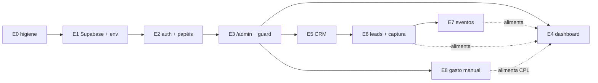

# 03 — Plano de execução

Regras de execução: cada entrega é pequena, funciona ponta a ponta e deixa o `main` verde (a `main` vai direto para produção na Vercel). Migration antes do código que a usa. Sem compat com versões antigas. Cada entrega termina com revisão de código antes do commit (fluxo do orquestrador). Responsáveis: DE = data-engineer, DF = dev-fullstack, UX = ux-designer, QA = qa-engineer, DO = devops, JF = Jonatan.

## 1. Visão por fase

| Fase | Objetivo | Entra | Saída verificável | Depende de |
|---|---|---|---|---|
| 1 Foundation | Base segura e mensurável | Supabase, auth, papéis, admin, dashboard real, CRM, leads, eventos, gasto manual, LGPD mínimo | Equipe entra no admin; vê funil real do teste público; leads capturados com consentimento | Projeto Supabase, textos legais |
| 2 Eneagrama AI | Eneagrama conversacional | Camada de IA no servidor, chat, extração do perfil a partir da conversa, `ai_usage`, módulo The Self AI, prompts versionados | Usuário conclui o Eneagrama conversando; custo por conversa visível | Fase 1, chave do provedor de IA, política de segurança/crise |
| 3 Mentor IA | Mentor pessoal com memória | Camadas A–E (doc 02), pgvector, pipeline assíncrono, tela "o que o Mentor sabe", Jornadas básicas | Mentor usa memória relevante; usuário vê/edita/apaga; orçamento de tokens respeitado | Fase 2, provedor de embeddings, fila/cron, validação jurídica |
| 4 Growth | Aquisição e retenção | Campanhas/UTM, e-mail e WhatsApp, coortes e retenção, conteúdo no CMS, voz (piloto) | Atribuição por canal; automação de nutrição de leads | Fase 1–3, contas de e-mail/WhatsApp |
| 5 Monetização | Assinatura | Planos configuráveis, Stripe e/ou Mercado Pago, webhooks idempotentes, limites por plano, Financeiro (receita), MRR/churn/CAC reais | Cobrança recorrente real e conciliada | Contas e chaves dos gateways, decisão de preços (JF) |
| 6 Marketplace | Psicólogos/terapeutas | Cadastro e verificação, vínculo e compartilhamento por escopo, agendamento, comissão, repasse, estorno | Primeira consulta paga e repassada | Gateway com split/repasse, jurídico (clínico x Mentor IA) |
| 7 Expansão | Escala | Voz plena, apps, novas línguas, B2B, API | A definir | Dados das fases anteriores |

Para as Fases 2 a 7 o detalhamento fino fica para um planejamento próprio quando a fase anterior terminar (evolução em camadas); aqui só ordem e dependências.

## 2. Fase 1: escopo exato

Dentro: tudo abaixo. Fora (não fazer agora): conversa com IA, memória, pagamento, marketplace, CMS de conteúdo, edição de estágios do CRM, kanban, automações de e-mail/WhatsApp, rollups de métricas, perfil público do cliente ("Meus dados" completo entra com a conta de cliente na Fase 2; ver nota LGPD em E6).

### Entrega 0: higiene da base (pré-requisito, pequena)

| Campo | Detalhe |
|---|---|
| Escopo | `.gitignore` com `.env*` e `!.env.example`; `lang="pt-BR"` (raiz e `error-page.ts`); 404/erro em português; corrigir `choose` e `useEffect` do teclado (`e.repeat`, deps, sem timer solto); aviso "não é diagnóstico clínico" (texto aprovado pelo JF); landmarks, `radiogroup`/`aria-*` e foco visível no quiz; fontes self-host; extrair `computeScores` para `features/eneagrama/domain/scoring.ts` com testes Vitest; versionar instrumento (`enneagram-v1`); instalar Vitest e script `test` |
| Responsável | DF (UX define o texto/foco visível), QA revisa casos de teste |
| Pronto quando | Lint e build passam; testes de pontuação cobrem: respostas vazias, todas 1, todas 5, empate, 162 respostas válidas; quiz navegável só com teclado e sem perda de resposta ao pressionar duas teclas rápido; leitor de tela anuncia grupo e opção marcada; nenhum texto em inglês nas telas de erro; aviso visível na intro, no resultado e no rodapé |
| Ponto de atenção | Dependência nova (Vitest) entra normalmente via pnpm |

### Entrega 1: Supabase client + env

| Campo | Detalhe |
|---|---|
| Escopo | `src/integrations/supabase/{client.ts,server.ts}` (browser, por request com JWT via `@supabase/ssr`, service role); validação zod das variáveis no startup do servidor; `.env.example`; `supabase/` inicializado (config, `migrations/` vazio com migration zero de extensões); `supabase gen types` gerando `types.ts`; função `getServerHealth` (server fn) que faz `select 1`-equivalente |
| Responsável | DF (cliente e env), DE (migration zero e tipos), DO (variáveis no ambiente de deploy) |
| Pronto quando | Rodando local e no preview, uma página interna temporária `/admin/health` ou comando documentado confirma conexão sem expor chave; build falha com mensagem clara se faltar variável obrigatória; service role não aparece em nenhum bundle do cliente (verificar com busca no `dist/`); `.env` ignorado pelo git (teste manual `git check-ignore`) |
| Depende de JF | Projeto Supabase criado e chaves entregues por canal seguro (ver seção 4) |

### Entrega 2: auth + papéis

| Campo | Detalhe |
|---|---|
| Escopo | Migrations (DE): `profiles`, `user_roles`, enum de papéis, `has_role()`, `is_staff()`, `audit_log`, RLS e testes de policy. App (DF): `/entrar` (e-mail + senha ou link mágico, a decidir com JF), logout, sessão por cookie SSR, `getAuthContext` (server fn), middleware `requireRole`, script/seed para criar o primeiro admin, tela mínima de erro "sem permissão". Proibido: auto-cadastro público que conceda papel de staff |
| Responsável | DE (schema e RLS), DF (auth), QA (casos de segurança) |
| Pronto quando | Usuário sem papel não lê `user_roles` de terceiros (teste SQL como `anon` e como usuário comum falha); admin consegue atribuir papel e a ação gera linha em `audit_log`; mudar papel direto via API pública é negado; sessão persiste ao recarregar (SSR) e some no logout; testes automatizados de policy rodam no CI; primeiro admin criado sem commitar credencial |
| Depende de JF | Decidir método de login e e-mail do primeiro admin; SMTP/remetente se usar link mágico ou confirmação (o SMTP padrão do Supabase tem limite baixo, não serve em produção) |

### Entrega 3: layout `/admin` + guard

| Campo | Detalhe |
|---|---|
| Escopo | `src/routes/admin.tsx` (layout route com sidebar shadcn, título "THE SELF MAP — ADMINISTRATION", `noindex`), `beforeLoad` com `getAuthContext`; `shared/roles.ts` (matriz), `shared/module-status.ts` (registro dos 17 módulos com status e fase); página padrão de módulo "Planejado/Necessita integração" mostrando fase e dependências; `robots.txt` bloqueando `/admin`; `StatusBadge`, `EmptyState`, `MetricUnavailable` |
| Responsável | UX (hierarquia, densidade, estados), DF |
| Pronto quando | Sem login, `/admin` redireciona para `/entrar?next=`; usuário sem papel de staff vê "sem permissão" (HTTP 403 na server fn); sidebar mostra só módulos permitidos ao papel, com badge de status; os 17 módulos aparecem, os sem código abrem a página de status (nenhum com tela falsa); teste que lista server functions do admin e falha se alguma não declarar `requireRole`; navegação por teclado e landmarks corretos; mobile utilizável (sidebar colapsável) |

### Entrega 4: dashboard com métricas reais

| Campo | Detalhe |
|---|---|
| Escopo | Migrations (DE): funções RPC por período (`from`,`to`) para: visitas/inícios/conclusões do teste, taxa de conclusão, contagem de contatos por estágio, leads por origem, distribuição de tipos, CPL; índices em `events (name, occurred_at)`. App (DF): seletor de período, cartões, funil, série diária; cartões sem fonte (MRR, churn, receita, custo de IA, marketplace, CAC) com `MetricUnavailable`; estado vazio explícito ("sem dados no período") |
| Responsável | DE (RPC + testes com dados de seed), DF, UX |
| Pronto quando | RPCs testadas com seed conhecido: cada número bate com a contagem manual; período sem dados mostra "sem dados", não zero enganoso nem número fixo; nenhum cálculo de agregação no cliente; staff sem permissão em Financeiro não vê o cartão (RPC protegido por papel); tempo de resposta aceitável com volume de teste (ex.: 100 mil eventos de seed) |
| Observação | Sem E6/E7/E8 os cartões ficam vazios; é esperado. **Sugestão de ordem (opcional, JF decide):** fazer E7 (eventos) antes de E4 para que o dashboard já nasça com dado real. A ordem pedida está mantida abaixo |

### Entrega 5: CRM contatos

| Campo | Detalhe |
|---|---|
| Escopo | Migrations (DE): `crm_contacts` (`user_id` nulo até conta; e-mail único normalizado, fonte, UTM, estágio atual), histórico de estágios, `crm_notes`, consentimentos (tabela append-only + textos versionados), RLS por papel. App (DF): lista (busca, filtro por estágio, paginação por cursor), ficha (dados, linha do tempo, notas, mudar estágio), criar/editar contato, Clientes como visão `user_id is not null` |
| Responsável | DE, DF, UX |
| Pronto quando | Operador cria contato, muda estágio e o histórico registra quem/quando; marketing lê mas não edita dados de contato; e-mail duplicado (com maiúsculas/espaços) é rejeitado; `select` explícito, sem `select *`; busca com índice (verificado por `EXPLAIN`); RLS testada por papel (matriz do doc 01); excluir/anonimizar contato implementado (LGPD) e testado |

### Entrega 6: leads + captura no teste atual

| Campo | Detalhe |
|---|---|
| Escopo | Migrations (DE): tabela de resultado do quiz (respostas por `question_id`, `instrument_version`, pontuações, tipo principal, ligada ao contato **apenas** com consentimento) com RLS sem acesso de staff ao detalhe das respostas (agregados via RPC). App (DF): no `Results`, formulário opcional "Receber meu resultado e conteúdos" com nome, e-mail, WhatsApp (opcional) e **checkbox de consentimento não pré-marcado** com texto versionado e link da política; server function pública (`captureLead`) com zod, honeypot, rate limit por IP (hash) e Turnstile/captcha (a decidir); cria/atualiza `crm_contacts` (estágio `engajado`), grava consentimento, grava resultado; visão Leads no admin (filtros, origem/UTM) |
| Responsável | DE, DF, UX (copy do consentimento com JF), QA (segurança) |
| Pronto quando | Visitante pode concluir o teste **sem** informar nada; ao informar e consentir, aparece em Leads em segundos com origem correta; sem checkbox marcado nada pessoal é gravado; reenvio com o mesmo e-mail atualiza, não duplica; spam simulado (50 envios/min) é barrado; `anon` não consegue ler nem escrever direto em `crm_contacts` (teste); política de privacidade, termos e canal do titular publicados e linkados **antes** de ir ao ar; exportação CSV só admin/operador e registra `audit_log` |
| Depende de JF | Texto da política e termos (jurídico), base/e-mail de contato do titular, escolha de captcha |

### Entrega 7: eventos do funil no teste

| Campo | Detalhe |
|---|---|
| Escopo | Migration (DE): `events` append-only (nome, `occurred_at`, `anon_id`, `contact_id` opcional, `properties` jsonb pequeno, `utm_*`, `instrument_version`), sem UPDATE/DELETE concedido, RLS: inserção só pelo servidor. App (DF): helper `track()` + server function `recordEvent` (zod, lista fechada de nomes); eventos: `quiz_viewed`, `quiz_started`, `quiz_question_answered` (agregável, sem a resposta), `quiz_completed`, `lead_form_viewed`, `lead_captured`, `result_printed`, `quiz_restarted`; `anon_id` aleatório em localStorage; UTM lido na primeira visita; nada de PII em `properties` |
| Responsável | DF, DE, QA |
| Pronto quando | Percorrer o teste completo gera a sequência esperada de eventos (teste e2e Playwright); nome de evento fora da lista é rejeitado; tentativa de update/delete em `events` falha; recarregar a página não duplica `quiz_started`; falha de rede no tracking nunca quebra nem trava o quiz; o funil do Dashboard (E4) passa a mostrar números que batem com o e2e; política de privacidade menciona medição anônima |

### Entrega 8: gasto de marketing manual

| Campo | Detalhe |
|---|---|
| Escopo | Migration (DE): `marketing_spend` (canal, período início/fim, valor `numeric`, moeda BRL, nota, `created_by`), RLS (marketing e financeiro escrevem; admin tudo). App (DF): módulo Marketing (lista, criar/editar com confirmação de exclusão, `audit_log`), CPL por canal e geral no Dashboard (gasto no período / leads capturados no período, só quando há gasto lançado) |
| Responsável | DE, DF |
| Pronto quando | CPL no Dashboard confere com cálculo manual em planilha; período sem gasto mostra "sem gasto lançado" (não zero); valores monetários sem arredondamento de ponto flutuante (`numeric`); operador sem permissão não edita; períodos sobrepostos no mesmo canal exibem aviso; CAC continua "Necessita integração" |

### Ordem e dependências da Fase 1

E0 pode correr em paralelo com a criação do projeto Supabase. E8 não depende de E5–E7 tecnicamente (só o CPL precisa de leads).

### Definição de pronto comum a toda entrega

1. Lint, typecheck e build passam; testes da entrega passam; cobertura da lógica nova ≥ 80%.
2. RLS/policies novas têm teste por papel (permitido e negado).
3. Server functions validam input com zod e declaram papel exigido.
4. Nenhum segredo no diff; `.env*` fora do git.
5. Telas novas: teclado, foco visível, labels, estados de carregando/vazio/erro em português.
6. Módulos e cartões com o rótulo de status correto; nenhum número sem fonte.
7. Revisão de código sem achado crítico antes do commit.

## 3. Fases 2 a 7: ordem priorizada (sem detalhar entregas)

| Fase | Primeiras entregas (ordem) |
|---|---|
| 2 | Camada de IA no servidor + `ai_usage` → chat em texto (streaming) com prompt versionado → extração do perfil → persistência de conversa com consentimento → painel The Self AI (versões, custo) → protocolo de crise e testes de segurança |
| 3 | Decisão de embeddings → migration pgvector e tabelas A–E → montador de contexto com orçamento → pipeline de sumarização/extração → recuperação híbrida → tela "o que o Mentor sabe" → avaliação offline → Jornadas básicas |
| 4 | UTM/atribuição → e-mail transacional e nutrição → coortes/retenção → CMS de conteúdo → piloto de voz |
| 5 | Planos (esquema + CRUD admin) → checkout do gateway escolhido → webhooks idempotentes e assinados → limites de uso de IA por plano → Financeiro (receita) → MRR/churn/CAC reais |
| 6 | Cadastro e verificação de profissionais → vínculo e escopo de compartilhamento → agenda/pedido → pagamento com split → repasse/estorno → conciliação |
| 7 | Priorizar com dados |

## 4. O que precisa do Jonatan

| Item | Quando | Detalhe |
|---|---|---|
| Projeto Supabase | Antes da E1 | Decisão tomada: **projeto Supabase próprio** (migrations versionadas em `supabase/`). Criar 2 projetos (staging e prod) se possível; região `sa-east-1` |
| Chaves do Supabase | E1 | URL, publishable key, service role e senha do banco. Entregar por canal seguro, nunca no chat do repositório nem em arquivo commitado. Quem configura no deploy: devops |
| Máquina local | E0/E1 | Instalar dependências (`pnpm install`), Supabase CLI e Docker (para `supabase start`), Node 22 ou superior (`engines` no `package.json`) |
| Primeiro admin | E2 | E-mail do primeiro administrador e método de login desejado |
| E-mail/SMTP | E2 | Remetente e provedor (ex.: Resend, SES) para confirmação/link mágico em produção; domínio com SPF/DKIM |
| Texto "não é diagnóstico" e copy do teste | E0 | Aprovar redação; **confirmar se a marca evita a palavra "Eneagrama" também no site** |
| Política de privacidade, termos, encarregado, canal do titular, texto de consentimento | Antes do deploy da E6 | Revisão jurídica; este plano não substitui advogado |
| Retenção de dados e base legal por finalidade | Antes da E6 | Prazos por categoria; lista de operadores |
| Captcha/anti-bot | E6 | Cloudflare Turnstile é a opção natural (funciona com qualquer host); precisa de conta/chaves |
| Domínio e URLs de redirect | E2 | URLs de produção e preview da Vercel para configurar no Auth do Supabase |
| Secrets de deploy | Antes do primeiro deploy | No GitHub: `VERCEL_TOKEN` e `VERCEL_ORG_ID`. Na Vercel: `VITE_SUPABASE_URL`, `VITE_SUPABASE_PUBLISHABLE_KEY` e `SUPABASE_SERVICE_ROLE_KEY` |
| Provedor de IA e chave | Antes da Fase 2 | Conta e chave de API (Claude por padrão) com limite de gasto mensal configurado |
| Provedor de embeddings | Antes da Fase 3 | Decisão (fixa a dimensão do vetor) |
| Revisão jurídica da memória e do Mentor | Antes da Fase 3 | Dados sensíveis, retenção, transferência internacional, protocolo de crise |
| Stripe e/ou Mercado Pago | Antes da Fase 5 | Contas, chaves de teste e produção, webhooks, regras de preço e plano |
| Jurídico do marketplace | Antes da Fase 6 | Responsabilidade clínica, verificação de registro profissional, comissão e estorno |
| Revisor psicométrico | Quando quiser tirar o rótulo "Necessita validação" do Eneagrama | Especialista para revisar itens e pontuação |

## 5. Riscos de execução

| Risco | Mitigação |
|---|---|
| Conflitos em `routeTree.gen.ts` ou arquivos de integração | Um dono por pasta; commits pequenos; regenerar pelo build |
| Migration aplicada em produção antes do código (ou o inverso) | Ordem fixa: migration → código; testar em staging; cada migration em passo único e reversível por nova migration (sem backward compat de código) |
| Server functions em runtime Vercel (cookies, Node APIs) | E1 já valida ponta a ponta no preview, antes de construir em cima |
| RLS com furo | Testes por papel obrigatórios em CI; revisão do data-engineer e do code-reviewer em toda migration |
| Escopo crescer (CRM sofisticado cedo demais) | Fase 1 entrega só o descrito; kanban, automações e CRUD de estágios ficam fora |
